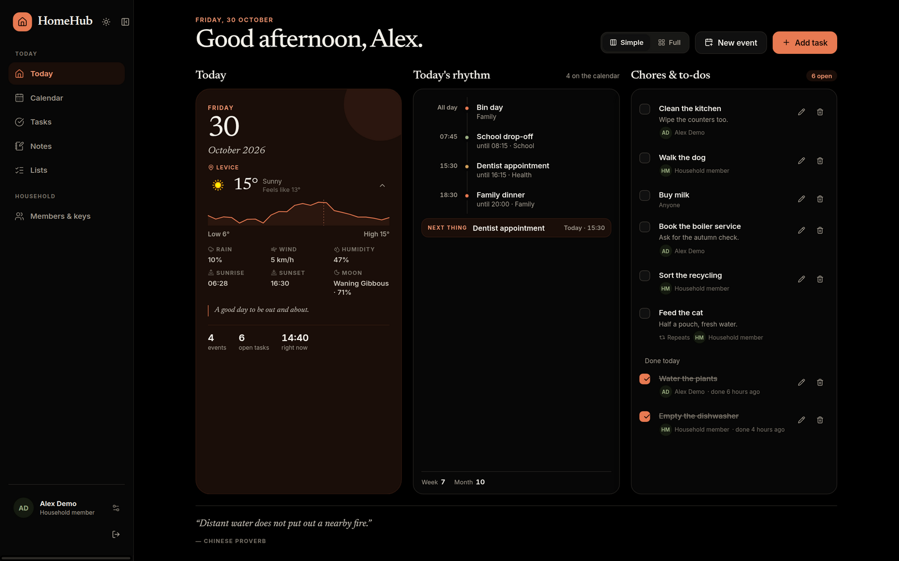
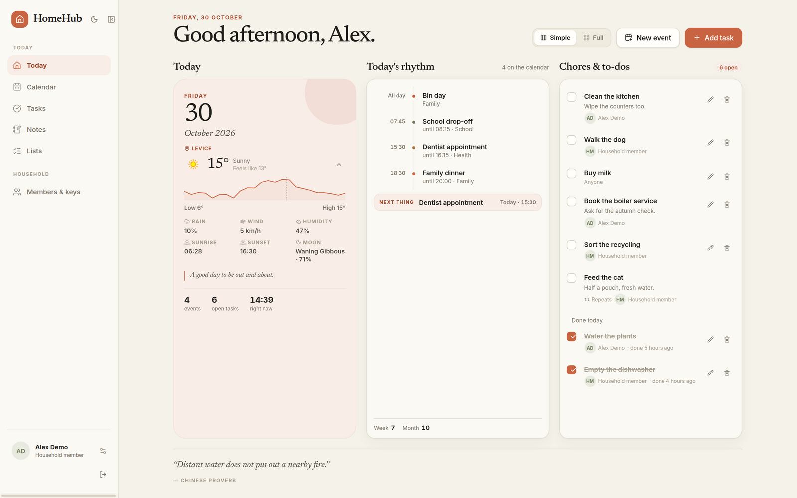
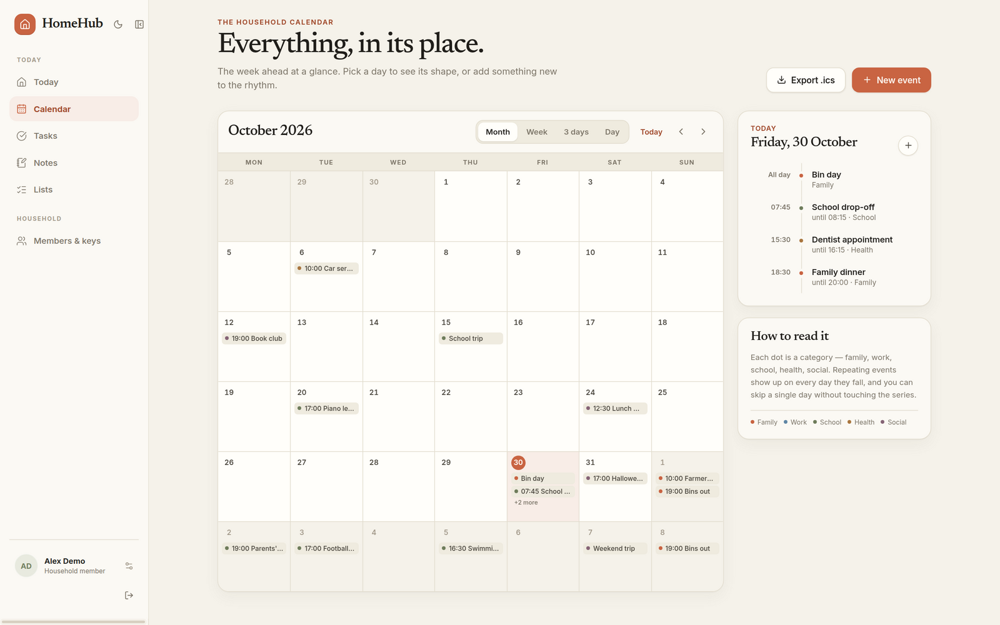
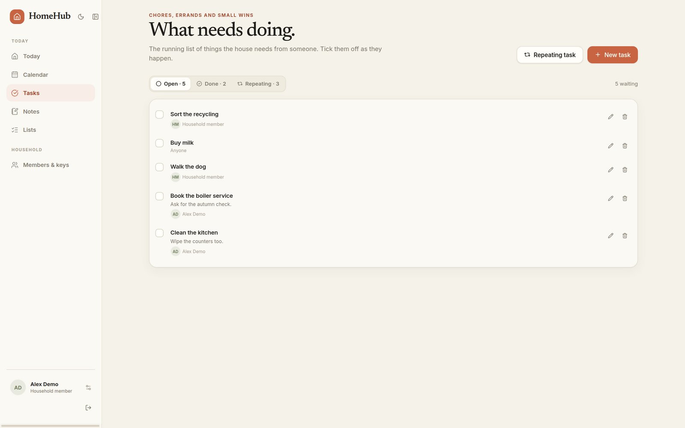
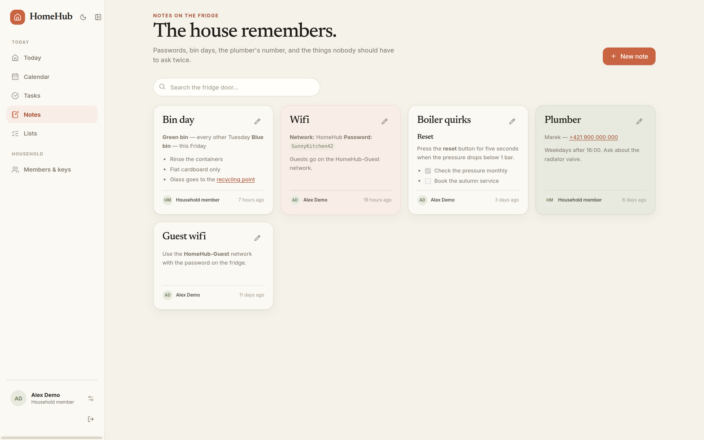
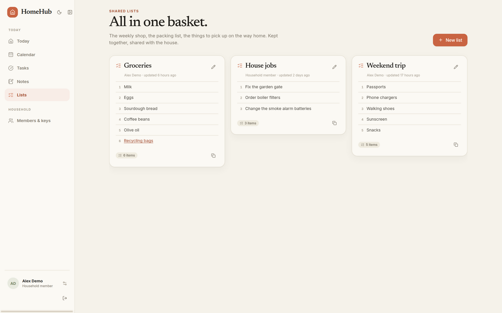
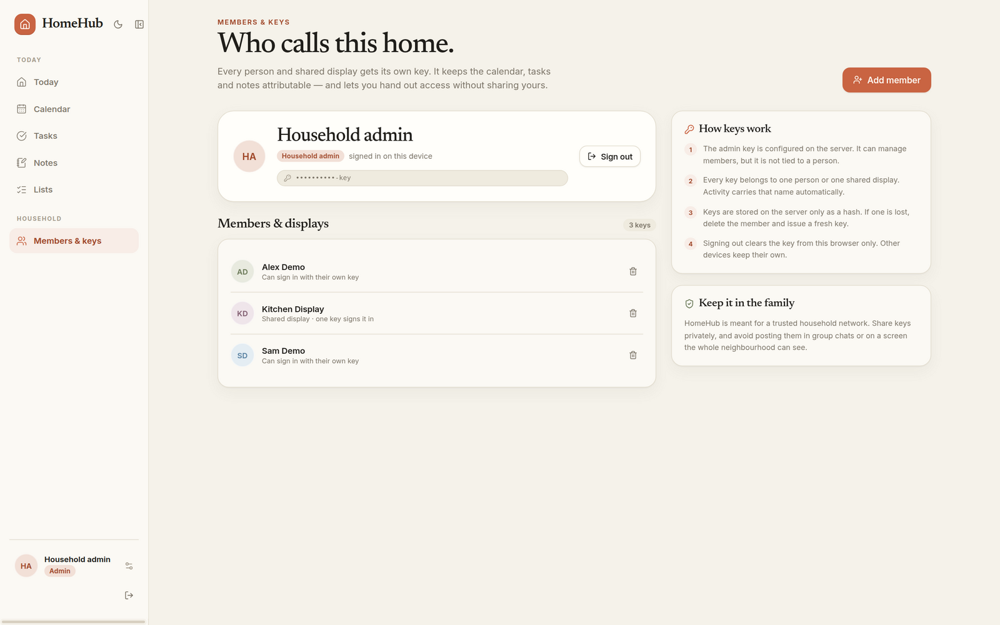

# HomeHub

**A calm, self-hosted household hub — one shared rhythm for the calendar, the
chores, the notes on the fridge, and the list everyone forgets.**



HomeHub runs on your own network as a single ASP.NET Core host with a React
front end. Every person and shared screen gets its own API key, and the house
stays in sync without a cloud account, a subscription, or a third-party service
in the middle.


## Features

- **Today at a glance** — a three-column wall-display view, or the fuller
  dashboard with weather, the fridge note, the shared list and a daily quote.
- **Calendar** — month, week, 3-day and day views; recurring events with
  exception dates; ICS export for other calendars.
- **Chores & recurring tasks** — recurring rules generate occurrences on the
  fly; completing one records it for that day.
- **Notes** — GitHub-flavoured Markdown (headings, lists, task lists, tables,
  links) with a live preview while you write.
- **Shared lists** — markdown links supported, one-click copy for the shop.
- **Household keys** — admin, member and shared-display keys, stored only as
  SHA-256 hashes.
- **Light and dark** — a warm paper palette by day, true black on AMOLED screens
  by night.
- **Self-contained** — publish one executable with the SPA embedded; the only
  external file is the SQLite database in the OS app-data folder.

## Screenshots



| Calendar                                   | Tasks                                |
| ------------------------------------------ | ------------------------------------ |
|  |  |

| Notes                                | Shared lists                                |
| ------------------------------------ | ------------------------------------------- |
|  |  |

| Household & keys                                    | Dark mode                                     |
| --------------------------------------------------- | --------------------------------------------- |
|  |  |

## Architecture

`HomeHub.Hub` is the only executable. It hosts the SPA and all gRPC services on
two plaintext ports — HTTP/1.1 for the web client, gRPC-Web and the ICS export;
HTTP/2 for gRPC. Domain projects own their entities and services;
`HomeHub.Integrations` talks to weatherapi.com and ZenQuotes, and every domain
shares one SQLite database through `HubDbContext`.

The client is React 19 + TypeScript with Vite, TanStack Query/Router/Form,
Connect (gRPC-Web) and StyleX. Routes are code-split, and the production bundle
is served from the hub itself.

```
HomeHub.Hub             single host: hosting, auth, EF Core, SPA, ICS export
HomeHub.Events          events, recurrence (Ical.Net), gRPC service
HomeHub.Tasks           tasks and recurring chores
HomeHub.Notes           notes on the fridge
HomeHub.Lists           shared lists
HomeHub.Users           members, display keys, BIP39 mnemonics
HomeHub.Integrations    weather and quote gRPC services
HomeHub.Client          React single-page app
```

## Getting started

Prerequisites: .NET 10 SDK, Node.js 20+ and, for the release build,
[go-task](https://taskfile.dev).

```bash
# terminal 1 — the hub
dotnet run --project HomeHub.Hub

# terminal 2 — the client (proxies /HomeHub.* and /api to :5000)
cd HomeHub.Client
npm install
npm run dev
```

Open <http://localhost:5173>. On first load the app asks for an API key.
`dotnet run` starts the hub in Development (via
`HomeHub.Hub/Properties/launchSettings.json`), which loads a gitignored
`appsettings.Development.json` for your local keys. Create it from the example:

```bash
cp HomeHub.Hub/appsettings.Development.example.json HomeHub.Hub/appsettings.Development.json
```

The admin key defaults to `test-key` there. Member and display keys are created
from **Members & keys**.

### Release build

```bash
task publish                  # build the SPA into Hub/wwwroot, then publish one file
./artifacts/linux-x64/HomeHub.Hub
```

Cross-publish with `task publish RID=win-x64` (or `osx-arm64`, `linux-arm64`).
The executable contains the SPA and the secret-free `appsettings.json`; runtime
settings come from the environment:

```bash
Authentication__AdminApiKey='choose-a-key' \
Weather__ApiKey='your-weather-key' \
Weather__Location='Lučenec, Slovakia' \
./artifacts/linux-x64/HomeHub.Hub
```

| Build | Size | Notes |
| --- | --- | --- |
| `task publish` | ~112 MB | self-contained, uncompressed; fastest start |
| `task publish:compressed` | ~54 MB | self-contained, compressed bundle; a little slower first start |

Native AOT is not available for the hub: EF Core builds its model and queries at
runtime, so an AOT publish compiles but aborts on startup (`Model building is not
supported when publishing with NativeAOT`). Trimming is likewise unsupported by
EF Core. A framework-dependent folder publish is ~11 MB but needs the .NET 10
runtime installed and is no longer a single file.

### Configuration and secrets

Secrets never live in the committed `HomeHub.Hub/appsettings.json`; that file is
bundled into releases and contains only defaults. Local keys belong in
`HomeHub.Hub/appsettings.Development.json` (gitignored, Development only), and
every setting can be overridden at run time with environment variables using
`__` in place of `:`:

| Variable                             | Purpose                                                 |
| ------------------------------------ | ------------------------------------------------------- |
| `Authentication__AdminApiKey`        | Admin key for user management and the first sign-in     |
| `Weather__ApiKey`                    | WeatherAPI key; leave unset to hide the weather block   |
| `Weather__Location`                  | City name, postcode, or `auto:ip` (default)             |
| `ConnectionStrings__DefaultConnection` | SQLite connection-string override                      |

**WeatherAPI:** register for a free key at
[weatherapi.com](https://www.weatherapi.com/) — sign up, then copy the API key
from your dashboard and set `Weather__ApiKey`. The free tier is plenty for a
household poll rate (the hub caches upstream data for an hour).

### Data

The database is created on first run in the OS app-data folder:

| OS      | Database                                                                          |
| ------- | --------------------------------------------------------------------------------- |
| Windows | `%LOCALAPPDATA%\HomeHub\homehub.db`                                               |
| macOS   | `~/Library/Application Support/HomeHub/homehub.db`                                |
| Linux   | `$XDG_DATA_HOME/HomeHub/homehub.db` (usually `~/.local/share/HomeHub/homehub.db`) |

Override the location with `ConnectionStrings__DefaultConnection`.

### Docker

A distroless image is included: it builds the SPA and the compressed single-file
hub, runs as a non-root user, and keeps the database on a `/data` volume. The
image declares `/data` as a volume; the example below mounts a named volume so
the database survives container upgrades.

```bash
docker build -t homehub .

docker run -d --name homehub \
  -p 5000:5000 -p 5001:5001 \
  -v homehub-data:/data \
  -e Authentication__AdminApiKey='choose-a-key' \
  -e Weather__ApiKey='your-weather-key' \
  -e Weather__Location='Lučenec, Slovakia' \
  homehub
```

Open <http://localhost:5000>. The runtime image is
`gcr.io/distroless/cc-debian12:nonroot` — no shell, no package manager, no
libicu (the hub is published with .NET invariant globalization for the
container). Configuration is environment-only, exactly like the release binary.

## Development

```bash
dotnet build HomeHub.sln
dotnet test HomeHub.sln

cd HomeHub.Client
npm run lint          # ESLint: size, complexity and hooks rules
npm run typecheck
npm run build
```

Frontend refactoring rules live in
[HomeHub.Client/REFACTORING.md](HomeHub.Client/REFACTORING.md). Hosting,
authentication and database details are in
[HomeHub.Hub/Readme.md](HomeHub.Hub/Readme.md); client development and
deployment notes are in [HomeHub.Client/Readme.md](HomeHub.Client/Readme.md).
